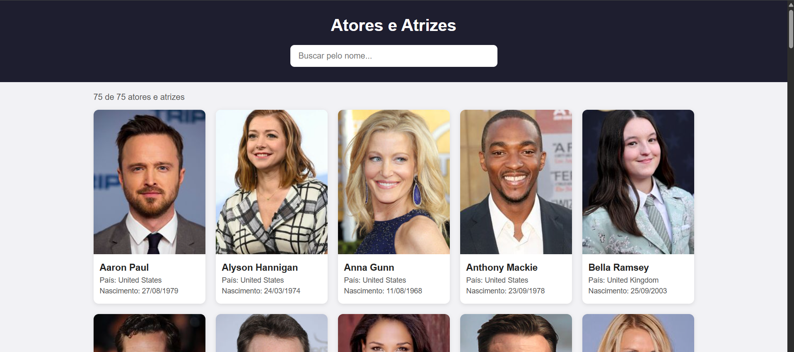
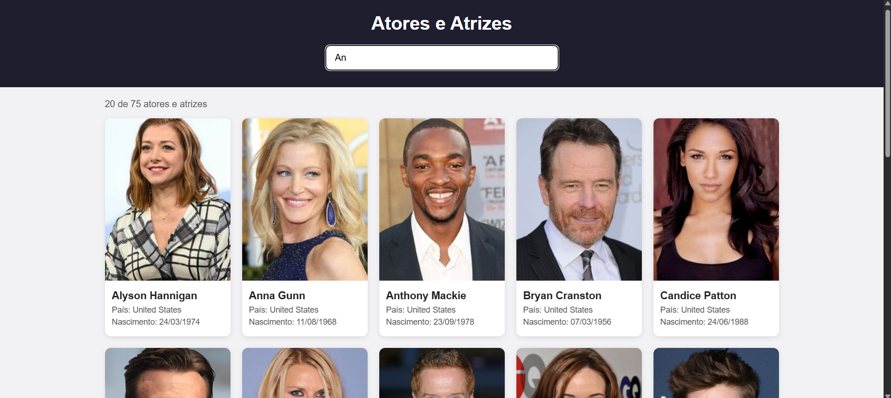

# CheckPoint 2 - Application Development
Daniel Silva de Castro - 2CCPS

Aplicativo web em HTML, CSS e JavaScript que mostra atores e atrizes do array em `dados.js` num grid de cards (foto, nome, país e data de nascimento) e filtra os cards pelo nome conforme o usuário digita, usando `oninput`, `filter()` e `includes()`.

## Snapshots

Tela ao abrir:

Tela com filtro aplicado:

